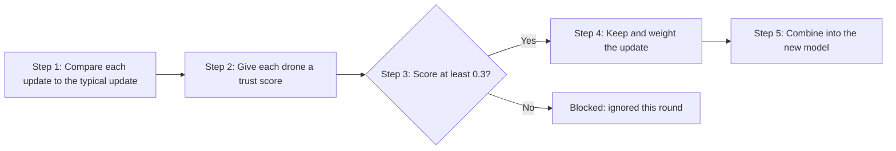

In the [previous post](/mzblog/posts/what-is-federated-learning/), we saw how drones learn together without sharing their data. But what if one drone cheats?

This is called **model poisoning**: a faulty or hacked drone sends a bad update that spoils the shared model.

## The study guide analogy

Imagine a class writing one shared study guide. Each student sends in their answers, and the guide is built from the average. If one student deliberately writes wrong answers, the guide gets worse for everyone.

The fix is simple in principle: **check each answer against the others, and ignore the answers that disagree.** The rest of this post shows how to do that with code.

## The four ideas, in one chain

These ideas are not alternatives. Each one feeds the next:



- **Cosine similarity** measures how closely two updates point in the same direction.
- **The median** gives the "typical" update, which one cheater cannot pull off course.
- **The trust score and threshold** decide who is kept and who is blocked.
- **The weighted average** combines the kept updates into the new model.

## Idea 1: Do the arrows agree?

Think of two compasses. If both point the same way, they agree. If they point in opposite directions, they disagree.

Cosine similarity gives a score from **-1 to +1**:
- **+1**: same direction (agree)
- **0**: unrelated
- **-1**: opposite direction (disagree)

Here is the code, with each line explained:

```python
import numpy as np                                    # NumPy: fast maths on arrays
def cosine(a, b):                                     # compare the directions of a and b
    dot = a @ b                                       # multiply matching numbers and add them up
    lengths = np.linalg.norm(a) * np.linalg.norm(b)   # multiply the two arrow lengths
    return dot / (lengths + 1e-12)                    # score from -1 to +1; 1e-12 avoids dividing by zero
```

## Idea 2: Use the median, not the mean

Imagine a class test where one student cheats and scores 1000. The average jumps far above everyone else. The **median** (the middle value) barely moves.

We use the median to find the "typical" update. Then a single bad drone cannot drag the reference away from the honest ones.

```python
def trust_scores(updates):                            # one trust score per drone
    ref = np.median(updates, axis=0)                  # typical update, middle value per number
    scores = []                                       # empty list for the results
    for u in updates:                                 # check each drone in turn
        scores.append(max(0.0, cosine(u, ref)))       # agreement, but never below 0
    return np.array(scores)                           # return the scores as an array
```

## Idea 3: A trust score and a threshold

Think of a bouncer checking names at a door. Each drone's score is checked against a line. Here the line is **0.3**: scores below it are blocked.

The threshold is a setting we choose, not a proven value. In research, we would test several values to find the best balance.

## Idea 4: A weighted average

Imagine a group vote where people you trust count for more. Trusted drones add to the new model in proportion to their trust score. Blocked drones add nothing.

```python
def aggregate(w_global, updates, threshold=0.3):      # combine only the trusted updates
    trust = trust_scores(updates)                     # score every drone
    keep = trust >= threshold                         # True = trusted, False = blocked
    if not keep.any():                                # if nobody is trusted this round...
        return w_global                               # ...keep the old model unchanged
    weights = trust[keep] / trust[keep].sum()         # weights add up to 1
    return w_global + weights @ updates[keep]         # weighted average, added to the model
```

## What this means in practice

Each round, the server runs `aggregate` on the updates from all drones. Bad drones get low trust and little or no influence. The shared model moves toward the honest answer.

## What this does not solve

This is a simple baseline, and it has limits:
- **Different data:** honest drones may see different things, so their updates can differ too. They might be blocked by mistake.
- **Privacy:** the server looks at each update, which is a weakness in some privacy settings.
- **Clever attacks:** a cheater who copies the honest pattern might get through.

Closing these gaps is the focus of ongoing research.

## Next post

In the next post, you can try the interactive demo and see these ideas move on screen.
