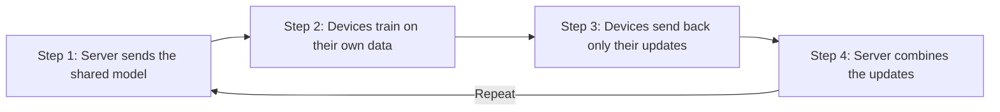

Machine learning (ML) usually needs lots of data in one place. But what if the data is private, or too big to send? That is where **federated learning (FL)** helps.

## Learning together, without sharing data

Imagine a group of students who must all learn the same subject. Instead of sending their notes to one teacher, each student studies at home. They then send back only a short summary of what they learned.

That is federated learning in a nutshell: **the learning moves to the data, instead of the data moving to the learner.**

## Why "federated"?

A federation is a group of separate parts that agree on shared rules, while each keeps its own things. Countries in a federation keep their own laws, but agree on common rules.

In FL, each device (a phone, a hospital, or a drone) keeps its own data. Only the learned changes are shared.

## The four steps

Federated learning repeats the same loop many times:

**Analogy:** a teacher sends a question sheet (the model), students solve it at home (training), they return their marks (updates), and the teacher averages the results (combining).

## Why this matters for drones

A team of **unmanned aerial vehicles (UAVs)**, or drones, is a good example. Each drone collects private video and sensor data. The radio links between drones are often weak, and batteries are small.

Federated learning lets the swarm learn together without sending all its data back to base.

## What comes next

Sharing only updates is safer, but it is not automatically safe. A faulty or hacked device can send a bad update that spoils the shared model. In the next post, I explain how to spot those bad updates.
