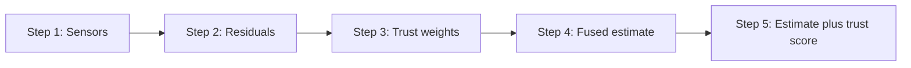

**Key point:** A battery model is only as good as the sensors feeding it. If one sensor slowly drifts, the model can be wrong and nothing warns you.

## Why sensors matter

A **battery management system (BMS)** is the small computer that keeps a battery safe and efficient. It cannot measure charge or health directly. It estimates them from sensors, such as voltage, current and temperature.

Newer research adds sensors *inside* the cell. In one study, an embedded thermocouple found that internal temperature was consistently and notably higher than surface temperature [1]. That is useful information, but only if the sensors can be trusted.

## Three groups of challenges

- **Sense:** sensors are noisy, can drift, and can fail.
- **Model:** turning signals into a state estimate is hard, and cells change as they age.
- **Deploy:** the system must run in real time, be explainable, and stay safe.

This post focuses on the first group: **can we trust the signal?**

## What can go wrong with a sensor?

A 2024 review lists these fault types [2]:

- **Bias:** a constant offset appears. Example: it always reads 1 °C too high.
- **Drift:** the error grows slowly over time.
- **Gain error:** readings are scaled wrongly. Example: 2% too high.
- **Intermittent fault:** the sensor works on and off.
- **Complete failure:** the sensor stops working.

A hard question is **ageing versus drift**. A slow change could be the cell ageing, or the sensor going wrong. One hypothesis is that ageing moves several sensors together, while drift hits one. That still needs testing.

## What already exists?

From a limited reading of the literature (not a full review):

- **Fusion:** one study fused voltage and cell expansion force for state of charge estimation [3]. In my reading, it does not detect or down-weight a faulty sensor.
- **Fault detection:** the 2024 review focuses on voltage, current and temperature sensors [2]. A 2026 study detects voltage and current sensor faults in battery packs with an autoencoder, and tests with injected faults [4].
- **Learned sensor weighting in other fields:** in robotics, one study used deep reinforcement learning to adjust the weights of two localization methods, together with residual-based anomaly detection [5]. In activity recognition, a 2026 preprint used reinforcement learning agents to learn a weight for each wearable sensor. Its authors list testing with deliberately induced sensor degradation as future work [6].

I found no battery study that learns sensor trust this way, but my search was small.

## An idea: fault-aware fusion

The idea is to make fusion notice when a sensor is going wrong, and trust it less.



- **Residual:** the prediction minus the measurement. A drifting sensor makes it grow slowly. Kalman filters (methods that predict a value, then correct it with measurements) produce a similar signal called the innovation. One well-known example applies extended Kalman filtering to battery management [7].
- **Trust weights:** a sensor with a large residual gets a small weight.
- **Down-weight, do not switch off:** a drifting sensor may still carry some information.
- **Trust score:** the output says which sensors were believed, which helps explain decisions.

## Where could reinforcement learning fit?

**Reinforcement learning (RL)** is learning by trial and reward. It could learn the trust weights as conditions change, for example as a cell ages.

There are real problems:

- **The reward problem:** on real cells there is no label saying "this sensor was wrong".
- **The plan:** train on **injected faults**, where the truth is known.
- **The test:** RL must beat simpler rules, such as the one in the example below. If a simple rule wins, use the simple rule.

**Status:** this is a planned experiment. It is unproven.

## Try it: a tiny drift example

Two sensors measure a slowly warming cell. Sensor B drifts after hour 40. We compare a plain average with a trust-weighted average.

```python
import numpy as np  # numpy handles the numbers and arrays

rng = np.random.default_rng(0)  # fixed random seed so results repeat
hours = np.arange(0, 100)  # 100 time steps, one per hour
true_temp = 25 + 0.05 * hours  # the real cell temperature slowly warms up
model_temp = 25 + 0.05 * hours  # a simple model that predicts that warming

sensor_a = true_temp + rng.normal(0, 0.2, 100)  # healthy sensor: truth plus small noise
sensor_b = true_temp + rng.normal(0, 0.2, 100)  # second sensor starts healthy too
drift = np.clip(hours - 40, 0, None) * 0.05  # drift ramps up slowly after hour 40
sensor_b = sensor_b + drift  # sensor B now drifts away from the truth

def trust_weights(readings, prediction, window=10, scale=0.5):  # turn residuals into weights
    residual = readings - prediction  # residual: measurement minus prediction
    smooth = np.convolve(residual, np.ones(window) / window, mode="same")  # average out the noise
    return 1.0 / (1.0 + (smooth / scale) ** 2)  # big residual means small trust

w_a = trust_weights(sensor_a, model_temp)  # trust for sensor A over time
w_b = trust_weights(sensor_b, model_temp)  # trust for sensor B over time

equal = (sensor_a + sensor_b) / 2  # baseline: plain average of both sensors
fused = (w_a * sensor_a + w_b * sensor_b) / (w_a + w_b)  # trust-weighted average

print("Error at hour 90, equal weights :", round(abs(equal[90] - true_temp[90]), 2))  # baseline error
print("Error at hour 90, trust weights :", round(abs(fused[90] - true_temp[90]), 2))  # weighted error
print("Trust in sensor B at hour 90    :", round(w_b[90], 2))  # how much sensor B is trusted
```

On my run it printed about **1.03** for equal weights, **0.03** for trust weights, and **0.04** trust in sensor B. The drifting sensor was almost ignored.

## What is simplified

- The data is **synthetic**, not from a real battery.
- The model is assumed to be **perfect**. Real models are not.
- The residual is a simple stand-in for a **full Kalman filter**.
- There is **no RL** here, only a fixed rule.
- Only **one fault type** (drift) is tested.

## Takeaways

- Sensors help only when they can be trusted.
- A slow drift can fool a model without any alarm.
- Fusion that weighs each sensor by its recent residual is a simple, explainable starting point.
- RL is a candidate, but it has to beat simple rules to earn its place.

## References

[1] B. Gulsoy, T. A. Vincent, J. E. H. Sansom, and J. Marco, "In-situ temperature monitoring of a lithium-ion battery using an embedded thermocouple for smart battery applications," *J. Energy Storage*, vol. 54, Art. no. 105260, 2022, doi: 10.1016/j.est.2022.105260. [Online]. Available: [https://doi.org/10.1016/j.est.2022.105260](https://doi.org/10.1016/j.est.2022.105260)

[2] Y. Zhao, L. Geng, S. Shan, Z. Du, X. Hu, and X. Wei, "Review of sensor fault diagnosis and fault-tolerant control techniques of lithium-ion batteries for electric vehicles," *J. Traffic Transp. Eng. (Engl. Ed.)*, vol. 11, no. 6, pp. 1447-1466, 2024, doi: 10.1016/j.jtte.2024.09.003. [Online]. Available: [https://doi.org/10.1016/j.jtte.2024.09.003](https://doi.org/10.1016/j.jtte.2024.09.003)

[3] S. Mao et al., "Multi sensor fusion methods for state of charge estimation of smart lithium-ion batteries," *J. Energy Storage*, vol. 72, Art. no. 108736, 2023, doi: 10.1016/j.est.2023.108736. [Online]. Available: [https://doi.org/10.1016/j.est.2023.108736](https://doi.org/10.1016/j.est.2023.108736)

[4] Y. Zhao, L. Geng, W. Meng, M. Niu, and C. Wu, "Sensor fault detection for lithium-ion battery packs using dual statistical indicators and a time-frequency fusion autoencoder," *Appl. Energy*, vol. 422, Art. no. 128308, 2026, doi: 10.1016/j.apenergy.2026.128308. [Online]. Available: [https://doi.org/10.1016/j.apenergy.2026.128308](https://doi.org/10.1016/j.apenergy.2026.128308)

[5] C.-C. Wong, H.-M. Feng, and K.-L. Kuo, "Multi-sensor fusion simultaneous localization mapping based on deep reinforcement learning and multi-model adaptive estimation," *Sensors*, vol. 24, no. 1, Art. no. 48, 2024, doi: 10.3390/s24010048. [Online]. Available: [https://doi.org/10.3390/s24010048](https://doi.org/10.3390/s24010048)

[6] D. Dey, T. Sen, and H. Mallick, "FedMHAR: Federated multimodal human activity recognition using multi-agent reinforcement learning," arXiv:2609.33492, 2026 (preprint, not peer reviewed). [Online]. Available: [https://arxiv.org/pdf/2609.33492](https://arxiv.org/pdf/2609.33492)

[7] G. L. Plett, "Extended Kalman filtering for battery management systems of LiPB-based HEV battery packs: Part 1. Background," *J. Power Sources*, vol. 134, pp. 252-261, 2004, doi: 10.1016/j.jpowsour.2004.02.031. [Online]. Available: [https://doi.org/10.1016/j.jpowsour.2004.02.031](https://doi.org/10.1016/j.jpowsour.2004.02.031)
